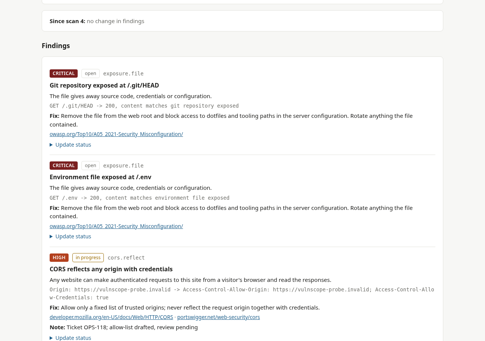
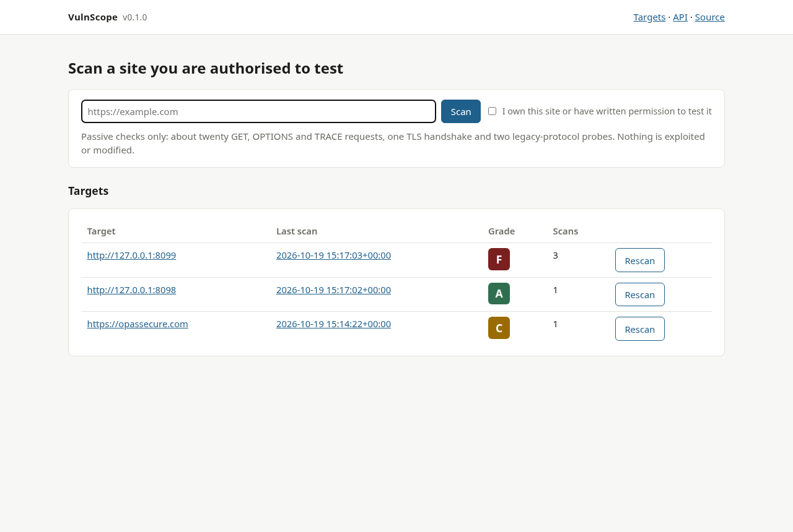
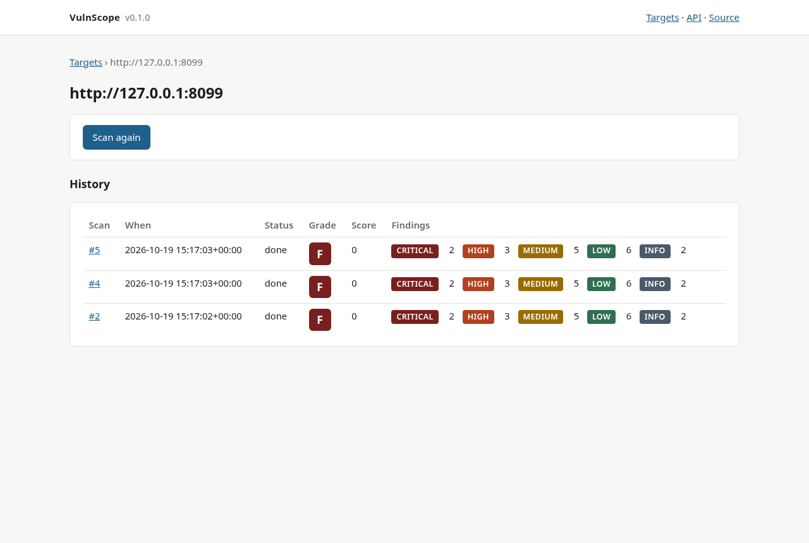
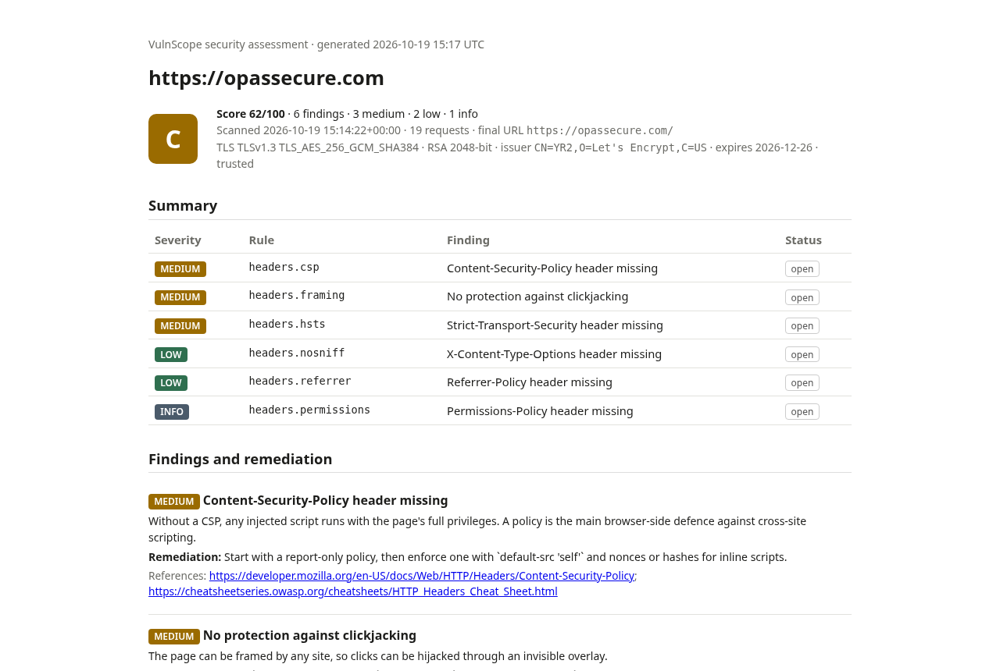

# VulnScope

[](https://github.com/Leonard-Opasanjo/vulnscope/actions/workflows/ci.yml)
[](pyproject.toml)
[](LICENSE)

VulnScope is a passive web security scanner for sites you own or are authorised to test. Give it a URL and it
checks the things that go wrong in deployment rather than in code: missing security headers, TLS and certificate
problems, cookies without their protective flags, directory listings and exposed files such as `.git` or `.env`,
permissive CORS and an enabled TRACE method. It rates every finding, grades the site from A to F, and writes an
HTML, JSON or PDF report with the evidence and the fix for each item.

It runs as a dashboard that keeps the history of every target, shows what changed between scans and lets you
track remediation per finding, and as a command-line tool for scripts and CI. A deliberately misconfigured
practice target ships with it, so you can see every check fire without touching anyone else's server.



## Contents

- [Purpose](#purpose)
- [Objectives](#objectives)
- [Who it is for](#who-it-is-for)
- [Safety and scope](#safety-and-scope)
- [What it checks](#what-it-checks)
- [Scoring and grades](#scoring-and-grades)
- [See it running](#see-it-running)
- [Install](#install)
- [Usage](#usage)
- [Scan history and remediation tracking](#scan-history-and-remediation-tracking)
- [Architecture](#architecture)
- [Tests and continuous integration](#tests-and-continuous-integration)
- [Security of the tool itself](#security-of-the-tool-itself)
- [Limitations](#limitations)
- [Roadmap](#roadmap)
- [About this project](#about-this-project)
- [Licence](#licence)

## Purpose

Most websites are not compromised through clever exploits. They are compromised because the server still
advertises `PHP/7.2`, because a `.git` directory sits in the web root with the database password in its history,
because a session cookie has no `HttpOnly` flag and a stored script reads it, or because the certificate ran out
on a Sunday and everyone clicked through the warning. These are configuration mistakes, they are visible from the
outside in a handful of requests, and the people who could fix them in ten minutes usually do not know they exist.

The commercial scanners that find these are priced for enterprises and the free ones are either one-shot web
forms with no history or full penetration-testing suites that need expertise to run safely. VulnScope sits in
the gap: a tool a small team can run against its own sites every week, that explains each finding in plain
language with the exact fix, that remembers what it found last time, and that produces a report fit for a
client or a manager.

## Objectives

1. **Find the common deployment mistakes from outside, safely.** Headers, TLS, cookies, exposed files, CORS and
   TRACE, with GET, OPTIONS and TRACE requests only and a fixed budget of about twenty requests per scan.
2. **Explain and prioritise.** Every finding states what it is, why it matters, the evidence observed, the
   remediation, and references, with a severity from critical to info and a single grade for the site.
3. **Keep history.** Every scan is stored; a target page shows the grade over time and each scan shows what is new
   and what was resolved since the previous one.
4. **Track remediation.** Each finding can be marked open, in progress, fixed or accepted with a note, and those
   decisions carry forward to the next scan automatically.
5. **Report in the formats people ask for.** A standalone HTML report, JSON for other tools, and PDF through a
   locally installed Chromium.
6. **Be safe to learn with.** A bundled practice target that exhibits every weakness, and its hardened twin, so
   the scanner can be exercised, demonstrated and tested without scanning anyone else.

## Who it is for

- **People who run a few websites** and want a weekly check that nothing obvious is wrong, with instructions they
  can act on without a security background.
- **Developers and DevOps engineers** who want a scan in CI after each deployment, failing on regressions.
- **Consultants and small security teams** who need a quick external baseline and a presentable report before a
  deeper assessment.
- **Students** learning what security headers, TLS settings and cookie flags do, with a target they can break and
  fix at will.

## Safety and scope

VulnScope only ever does the following to a target:

- Fetches the home page with GET, following redirects that stay on the same site (up to five hops).
- Fetches a short fixed list of well-known paths with GET: nine directory names that commonly have listings
  enabled and five files that should never be public (`/.git/HEAD`, `/.env`, `/phpinfo.php`, `/server-status`,
  `/.DS_Store`). A file counts as exposed only when the body matches the expected content, so a soft 404 is not
  reported.
- Sends one GET with a probe `Origin` header, one OPTIONS and one TRACE request to the home page.
- For HTTPS targets, one plain-HTTP request to see whether it redirects, one TLS handshake to read the
  certificate, and two handshakes that offer only TLS 1.0 and TLS 1.1 to see whether the server still accepts
  them.

That is roughly twenty requests, sent with at most four in flight and a User-Agent that names the tool and links
to this repository. VulnScope never logs in, submits forms, guesses credentials, fuzzes parameters, downloads
files, or sends anything other than those requests. It is a configuration check, not a penetration test.

Authorisation is yours to confirm, not the tool's to verify: the dashboard requires the checkbox and the CLI
requires `--authorized` on every scan. Scanning systems you do not own or have written permission to test may be
illegal where you live, regardless of how passive the requests are.

## What it checks

| Category | Check | Severity |
|---|---|---|
| Transport | Site served over plain HTTP | high (info on a loopback address) |
| Transport | HTTP does not redirect to HTTPS | medium |
| TLS | Certificate not trusted (self-signed, unknown issuer, wrong name, missing chain) | high |
| TLS | Certificate expired / not yet valid | critical |
| TLS | Certificate expires within 14 days / within 30 days | high / medium |
| TLS | Negotiated protocol below TLS 1.2 | high |
| TLS | Server still accepts TLS 1.0 or 1.1 | medium |
| TLS | RSA key shorter than 2048 bits; SHA-1 or MD5 signature | medium |
| TLS | TLS 1.3 not negotiated | info |
| Headers | `Strict-Transport-Security` missing / max-age under six months / no includeSubDomains | medium / low / info |
| Headers | `Content-Security-Policy` missing / no script restriction / `'unsafe-inline'` without nonce / wildcard | medium / low |
| Headers | No clickjacking protection (`X-Frame-Options` or `frame-ancestors`) | medium |
| Headers | `X-Content-Type-Options` missing | low |
| Headers | `Referrer-Policy` missing | low |
| Headers | `Permissions-Policy` missing | info |
| Headers | `Server` header with a version number; `X-Powered-By` and similar | low |
| Cookies | `Secure` missing on HTTPS; `HttpOnly` missing | medium |
| Cookies | `SameSite` missing; `SameSite=None` without `Secure` | low / medium |
| Exposure | Directory listing enabled | high |
| Exposure | `.git/HEAD` or `.env` readable | critical |
| Exposure | `phpinfo.php` readable; Apache `server-status` readable; `.DS_Store` readable | high / medium / low |
| CORS | Any origin reflected with credentials / without credentials | high / medium |
| CORS | Wildcard with credentials / wildcard without credentials / null origin allowed | high / info / medium |
| Methods | TRACE responds / TRACE advertised in `Allow` | medium / low |

Each row in the report carries the evidence (the header value, the cookie, the path and status, the certificate
dates), a remediation with the exact directive for common servers, and links to the MDN or OWASP page.

## Scoring and grades

The score starts at 100 and deducts 40 per critical, 20 per high, 10 per medium and 4 per low finding; info
findings cost nothing. Grades are A (90 and above), B (75), C (60), D (40) and F (below 40). The scale is
deliberately harsh at the top: one exposed `.env` file is a D on its own, because that is how serious it is.

A good grade means the common configuration mistakes are absent. It says nothing about the application's logic,
authentication, injection flaws or anything that needs a logged-in session.

## See it running

The practice target scores an F, with every check firing:

```
$ vulnscope target &                       # serves http://127.0.0.1:8099
$ vulnscope scan http://127.0.0.1:8099 --authorized
http://127.0.0.1:8099 -> grade F (score 0/100), 18 findings, 18 requests
  critical exposure.file          Git repository exposed at /.git/HEAD
  critical exposure.file          Environment file exposed at /.env
  high     cors.reflect           CORS reflects any origin with credentials
  high     exposure.file          phpinfo() page exposed at /phpinfo.php
  high     exposure.listing       Directory listing enabled at /files/
  medium   cookies.httponly       Cookie session is readable by JavaScript
  medium   cookies.httponly       Cookie prefs is readable by JavaScript
  medium   headers.csp            Content-Security-Policy header missing
  medium   headers.framing        No protection against clickjacking
  medium   methods.trace          HTTP TRACE is enabled
  low      cookies.samesite       Cookie session has no SameSite attribute
  low      cookies.samesite       Cookie prefs has no SameSite attribute
  low      headers.nosniff        X-Content-Type-Options header missing
  low      headers.referrer       Referrer-Policy header missing
  low      headers.server         Server header reveals the software version
  low      headers.x-powered-by   x-powered-by header reveals the technology stack
  info     headers.permissions    Permissions-Policy header missing
  info     transport.plain        Target served over plain HTTP (local address)
```

The hardened twin (`vulnscope target --secure`) scores an A with only the "local plain HTTP" note. And a real
site, my own, scanned the day this was written:

```
$ vulnscope scan https://opassecure.com --authorized
https://opassecure.com -> grade C (score 62/100), 6 findings, 19 requests
  medium   headers.csp            Content-Security-Policy header missing
  medium   headers.framing        No protection against clickjacking
  medium   headers.hsts           Strict-Transport-Security header missing
  low      headers.nosniff        X-Content-Type-Options header missing
  low      headers.referrer       Referrer-Policy header missing
  info     headers.permissions    Permissions-Policy header missing
```

TLS 1.3 with a trusted 2048-bit certificate and no legacy protocols accepted, but six headers short of an A. The
fix is a dozen lines of nginx configuration, which is the point: the report tells you exactly which.

The dashboard lists every target with its latest grade and lets you rescan with one click:



A target's history shows the grade and finding counts for every scan:



The HTML report is a standalone page you can send or print to PDF:



## Install

Python 3.11 or newer.

```bash
git clone https://github.com/Leonard-Opasanjo/vulnscope.git
cd vulnscope
python -m venv .venv && . .venv/bin/activate      # or: uv venv && . .venv/bin/activate
pip install -e ".[dev]"                            # or: uv pip install -e ".[dev]"
```

Docker:

```bash
docker build -t vulnscope .
docker run -d -p 127.0.0.1:8000:8000 -v vulnscope-data:/data vulnscope      # dashboard on http://localhost:8000
docker run --rm vulnscope vulnscope scan https://example.com --authorized --no-save
```

The image runs as an unprivileged user and keeps the database in the `/data` volume. PDF export needs Chromium,
which the image does not include; use the host for PDFs or install it in a derived image.

## Usage

### Dashboard

```bash
vulnscope serve                      # http://127.0.0.1:8000, database ./vulnscope.db
vulnscope serve --port 9000 --db /srv/vulnscope/scans.db
```

Enter a URL, tick the authorisation box, and the scan runs in the background while the page refreshes. The scan
page shows the grade, the counts, the TLS summary, what changed since the previous scan of the same target, and
every finding with its remediation and a status form. The target page lists all scans. Every scan has HTML, JSON
and (with Chromium installed) PDF exports, and an API at `/api/scans/{id}` and `/api/targets`, documented at
`/api/docs`.

### Command line

```
vulnscope scan URL --authorized [options]
vulnscope report SCAN_ID [--html F] [--json F] [--pdf F] [--db PATH]
vulnscope serve [--host H] [--port P] [--db PATH]
vulnscope target [--host H] [--port P] [--secure]
```

| `scan` option | Default | Meaning |
|---|---|---|
| `--authorized` | required | confirm you own the target or have written permission to test it |
| `--html FILE`, `--json FILE`, `--pdf FILE` | | write the report in that format |
| `--db PATH` | `vulnscope.db` or `$VULNSCOPE_DB` | database that keeps the history |
| `--no-save` | | scan without recording anything |
| `--ca-bundle FILE` | system store | trust this CA bundle (internal CAs, test certificates) |
| `--insecure` | | skip certificate verification entirely |
| `--timeout SECONDS` | 10 | per-request timeout |
| `--no-legacy-probe` | | skip the TLS 1.0 and 1.1 handshakes |

Exit codes: 0 on a completed scan (whatever the grade), 2 when the target cannot be scanned or an option is
invalid. A grade-based exit code for CI is on the roadmap; until then, read `grade` from the JSON output.

### Practice target

```bash
vulnscope target                 # misconfigured on purpose, http://127.0.0.1:8099
vulnscope target --secure        # the hardened version
```

The target is a small Starlette application in `vulnscope/target.py`. The insecure version sets no protective
headers, advertises `Apache/2.4.29` and `PHP/7.2.24`, sets two cookies without flags, lists `/files/`, serves
`/.env`, `/.git/HEAD` and `/phpinfo.php`, reflects any CORS origin with credentials, and answers TRACE. None of
the "secrets" it serves are real.

## Scan history and remediation tracking

Every scan of a target is kept, and each finding has a stable key (the check plus, where relevant, the cookie
name or path), which is what makes history useful:

- The scan page lists findings that are **new** since the previous completed scan and those that were
  **resolved**.
- A finding's status and note are set once and **carried forward**: `accepted` and `in progress` stay on the
  finding in later scans as long as it keeps appearing. A finding marked `fixed` that appears again comes back
  as `open` with a note saying it reappeared, so regressions are visible.
- The target page shows the grade, score and counts of every scan, which is the trend line for a site.

Statuses are `open`, `in_progress`, `fixed` and `accepted`. "Accepted" is for a risk the owner has decided to
live with; the note should say who decided and why, because it will be in the report.

## Architecture

```
vulnscope/
├── checks.py      Finding model, scoring, and the header, cookie, exposure, CORS, method and transport checks
├── tls.py         certificate and protocol inspection (ssl + cryptography), and the TLS checks
├── scanner.py     one scan: redirects, request budget, the check sequence, results
├── db.py          SQLite store: targets, scans, findings, status carry-over, diffs
├── report.py      Jinja2 HTML report, JSON, PDF via local Chromium
├── web.py         FastAPI dashboard and API
├── cli.py         scan / report / serve / target
├── target.py      the practice target and its hardened twin
└── templates/     dashboard pages and the standalone report
tests/             unit tests for every check, and the scanner, store, dashboard and CLI against the real targets
```

Design decisions:

- **Checks are pure functions.** Each takes observed data (headers, cookies, a response body, a certificate) and
  returns findings. They are tested exhaustively without a network, and the scanner is a thin sequence of fetches
  around them.
- **Signatures, not status codes.** A 200 for `/.env` means nothing on a site that returns 200 for everything.
  Exposure findings require the body to match what the file would contain.
- **Redirects stay on the site.** The scanner follows up to five redirects only to the same host, a subdomain or
  a parent domain. A redirect elsewhere ends the chain, so a scan can never spill onto a third party.
- **Untrusted certificates do not stop the scan.** The TLS check reports the problem at high severity and the
  remaining checks run over the unverified connection; nothing sensitive is sent.
- **The dashboard sends the headers it checks for.** Scanning VulnScope with VulnScope should give an A, and
  there is a test for the headers.
- **SQLite, standard library.** One file, no server, no ORM; the store is about two hundred lines and the schema
  is in it.
- **PDF through the browser you already have.** A headless Chromium prints the HTML report; no PDF library, no
  rendering differences between the HTML and the PDF.

## Tests and continuous integration

```bash
ruff check .
pytest                                    # 28 tests
bandit -q -c pyproject.toml -r vulnscope
pip-audit
```

The unit tests cover every check at its thresholds (each severity window, CSP quality, cookie attribute
combinations, soft-404 handling, CORS variants, the scoring table). The integration tests start the practice
targets in-process and assert that the insecure one gets an F with every expected finding, that the hardened one
gets an A, that an HTTPS target with a self-signed certificate (generated with `openssl` during the test) is
reported as untrusted and then trusted when the CA bundle is supplied, that redirects, budgets and unreachable
hosts behave, and that the dashboard, status carry-over, diffs, reports, API and CLI work end to end.

CI runs the same on Python 3.11, 3.12 and 3.13, builds the Docker image and smoke-tests the dashboard in it, and
runs [SecureFlow](https://github.com/Leonard-Opasanjo/secureflow-devsecops), the DevSecOps pipeline from the
sibling project, which scans this repository with Bandit, Semgrep, Gitleaks and pip-audit and publishes the
results to the Security tab.

## Security of the tool itself

- **The dashboard has no authentication.** It binds to `127.0.0.1` by default. Anyone who can reach it can
  start scans of arbitrary URLs from your machine, which makes an exposed instance a request proxy. Put it behind
  a reverse proxy with login if a team needs it, and do not expose it to the internet.
- **It fetches URLs you give it, including private ones.** That is required for scanning local and internal
  targets and is why the previous point matters.
- **Scanned content is untrusted.** Response bodies are only pattern-matched, never rendered or executed; the
  dashboard escapes everything it displays and sends a Content-Security-Policy; the report escapes all values.
- **No outbound calls beyond the target.** No telemetry, no reputation lookups.
- **The practice target is fake.** Its "secrets" are placeholders; still, run it on localhost only.
- Report a problem with VulnScope itself through [SECURITY.md](SECURITY.md).

## Limitations

- Passive and shallow by design: one page, a fixed path list, no crawling, no authentication, no parameter
  testing. It will not find injection, access-control or business-logic flaws.
- Cookie checks see only the cookies set on the home page and its redirects. Login cookies set after
  authentication are not observed.
- The legacy TLS probe depends on the local OpenSSL being willing to offer TLS 1.0 and 1.1 at all. When it refuses,
  the check is skipped rather than reported, and the JSON shows `legacy_probed: false`.
- Certificate chain problems are reported through the system trust store of the machine running the scan, which
  can differ from a browser's.
- Directory-listing and exposed-file checks use a short fixed list of paths. A listing at `/data/` or a backup
  named differently is not found.
- Grades are a heuristic. Two sites with the same grade can differ a great deal in actual risk; read the findings.
- One scan at a time per target in the dashboard; there is no scheduler. Use cron with the CLI for recurring scans.

## Roadmap

- `--fail-on GRADE` and `--fail-on SEVERITY` exit codes for CI gates.
- Scheduled rescans in the dashboard with e-mail or webhook on a changed grade.
- `security.txt`, `robots.txt` and `sitemap.xml` observations; subresource integrity on included scripts.
- Light crawling of same-site links (a bounded number of pages) so cookies and headers on other pages are seen.
- DNS checks: CAA, DNSSEC, dangling CNAMEs.
- A comparison view of two scans side by side.

## About this project

VulnScope is the third in a series of open-source security tools I am building to show practical security
engineering end to end: [LogSentinel](https://github.com/Leonard-Opasanjo/logsentinel) analyses what happened on a
host, [SecureFlow](https://github.com/Leonard-Opasanjo/secureflow-devsecops) stops vulnerabilities before they
ship, and VulnScope checks what the world can see once they have. Each one is working code with tests, a
sample you can experiment on, and documentation that explains the reasoning.

Issues and pull requests are welcome; [CONTRIBUTING.md](CONTRIBUTING.md) explains how to add a check.

## Licence

MIT. See [LICENSE](LICENSE).
